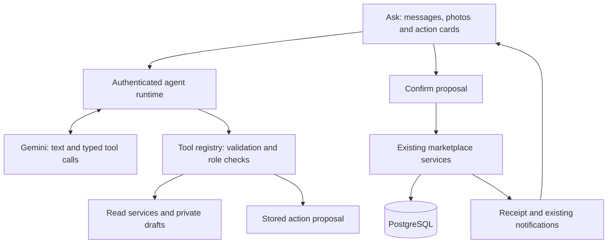

# Ask: marketplace chat agent plan

Status: target design, 2026-10-17. The session/history/image/tool foundation is
implemented; see `ask-agent-handoff.md` for current capabilities and limits.
User direction: all user-facing marketplace workflows should be
reachable through Ask, including finding items and donating products.

## Product direction

Ask becomes the conversational entry point to NeighbourHood. People describe
what they need or want to give away in English or Bahasa Indonesia, attach
photos, refine results, and carry out marketplace actions in the conversation.
Explore, Activity, Messages and Profile remain useful direct controls. Both
interfaces use the same services and permissions.

The agent remembers the current task: selected item, search filters, draft,
dates, missing fields and pending action. It asks a short clarification when a
required fact is missing. It presents real item cards and editable drafts,
rather than answering every task with a block of text.

Product categories use the existing shared taxonomy. There is no separate
assistance workflow for one category.

## Representative journeys

1. **Find and request:** "I need a rice cooker nearby" -> search from the
   user's saved area -> item cards -> "the second one" resolves to a stable
   listing ID from that result set -> request preview -> user confirms ->
   request receipt and link to its private conversation. If an owner has not
   approved it, the agent says it is pending and does not claim a reservation.
2. **Donate:** photo + "give this away" -> private draft with title/category
   suggestions -> ask about condition, quantity and other missing facts ->
   secure pickup controls -> editable preview -> Publish -> listing receipt.
   Photos do not establish working condition, dimensions, expiry or brand.
3. **Manage an item:** "pause my rice cooker listing" -> resolve the user's
   listing -> status-change preview -> confirm -> refreshed listing card.
4. **Manage requests:** "who wants my books?" -> incoming requests -> approval
   preview with quantity and pickup deadline -> confirm -> reserved stock and
   the usual inbox update. In-person handover confirmation remains explicit.
5. **Borrow:** "borrow a drill this weekend" -> clarify local dates -> search
   lending listings -> show terms/availability -> loan-request preview ->
   confirm. Approval, checkout and return follow the existing loan rules.
6. **Communicate:** "tell the owner I can collect tomorrow at 5" -> resolve the
   request/conversation -> show exact message and recipient -> Send -> receipt.
   Ask is distinct from the private neighbour-to-neighbour chat.
7. **Community:** discover/join communities, find collection points, inspect
   inventory and propose deposits. Eligible volunteers can review deposits
   and adjust inventory; eligible moderators can manage community membership.

## Tool catalogue and ownership

Names below describe planned capabilities, not existing exported functions.
Use specific typed tools with a common execution envelope. Do not expose a
generic database, SQL, HTTP, arbitrary URL or arbitrary function-execution tool.

| Capability | Read/draft tools | Actions with a concrete review card | Service owner / readiness |
|---|---|---|---|
| Discovery | `search_listings`, `get_listing`, `list_categories` | None for browsing | Engineer 1; listing HTTP endpoints are currently stubs, nearby repository exists |
| My listings | `list_my_listings`, `upsert_listing_draft`, `inspect_listing_photo` | Publish, edit public listing, pause/reactivate/close | Engineer 1; listing service and photo adapter needed |
| Needs | `list_saved_needs`, `draft_need` | Save/delete a reviewed need | Engineer 2; save/list/delete implemented |
| Donation requests | `list_requests`, `get_request`, `prepare_donation_request` | Request, approve, reject, cancel, confirm handover | Engineer 2; implemented service can be reused |
| Lending | `list_loans`, `get_loan`, `prepare_loan_request` | Request, approve/reject/cancel, checkout, return | Engineer 1; persistence exists, service/HTTP integration needed |
| Private chat | `list_conversations`, `get_conversation_messages`, `draft_message` | Send the displayed message to the displayed recipient | Engineer 2; implemented |
| Inbox | `list_notifications` | Mark as read after explicit interaction | Engineer 2; implemented; browser push opt-in is a separate browser control |
| Communities | `list_communities`, `get_community`, `get_points`, `get_inventory` | Join, propose deposit | Engineer 1; endpoints currently stubs |
| Volunteer/moderator work | Read permitted deposits/members/inventory | Review deposit, adjust stock, change a permitted community role | Engineer 1; enforce the same role rules at execution |
| Profile/location | Read minimal area/language/search preferences | Update the displayed profile/preferences | Arung; profile service exists; exact location uses secure UI controls |

Ask does not grant platform roles or replace authentication/account-linking.
QR scanning and device location require a browser UI interaction. Automatic
expiry and push delivery remain backend/browser responsibilities rather than
decisions for the model.

Start with one agent and a typed tool registry. Supply tools appropriate to
the authenticated role and active workflow. Expand tool groups as capabilities
are wired; there is no need for several cooperating agents for this design.

## Action execution

Search and private draft preparation can run during conversation. Marketplace
writes produce an action proposal. The UI shows the exact item, quantity,
dates, recipient and consequence, with Edit / Confirm / Cancel controls.

1. The server validates tool arguments and resolves the target from authorized
   resources. "The second one" refers to a stored result set, not a guessed ID.
2. A proposal stores the validated payload, user/session, resource IDs and
   current state, expiry, and a payload hash. Use the resource's `updatedAt`
   or a service-specific version where available.
3. Confirm submits only the proposal ID and an idempotency key. The server
   loads its own payload, rechecks permissions and current stock/status/dates,
   and invokes the owning service. Changing a draft invalidates its old
   proposal. A stale proposal returns a refreshed preview.
4. The transaction result becomes a deterministic receipt. The model may
   explain it, but the UI renders success from the committed result. A later
   model failure cannot hide a successful write or trigger another write.

A plain "yes" may refer to several things. For the first implementation, use
the action card button for committed marketplace actions. Model-callable tools
prepare actions; the confirmation executor is not exposed as an unrestricted
tool. Multi-action requests produce independently reviewable actions; do not
imply that several service transactions are atomic.

## Runtime and service boundary

The backend owns the tool loop. It authenticates the user, loads session
context, calls the model, validates calls, executes permitted tools and returns
tool results until there is an answer, clarification or action card. Call
services directly; do not loop through the application's own HTTP endpoints
or implement a second copy of stock/loan authorization inside the agent.

Use configurable initial limits: four model rounds, six tool executions and
a 45-second total turn deadline. Serialize writes and dependent tool calls;
parallelize independent reads only. Limit and truncate returned records.
Allow one active run per session, with a client message ID to deduplicate
retries. Cancel stops new work; it does not undo an already committed action.

Keep API keys and Firebase token verification on the server. User identity,
ownership and roles come from authentication, never model-generated arguments.
Listing text, photos and neighbour messages are data, not instructions. Test
that malicious content cannot change tool permissions or authorize a write.

## Gemini integration

The current `GeminiAdapter.generateJson()` handles a single structured-output
call. Preserve it for extraction/photo tasks and add a separate agent adapter
that normalizes provider text, tool calls, tool results and streaming events.
Verify its types against the pinned `@google/genai` 2.30.0 package; do not extend
the current narrow SDK cast by guessing fields from another API/version.

Gemini custom function calling supports the model choosing a function and the
application executing it and returning its result. See the official
[function calling guide](https://ai.google.dev/gemini-api/docs/function-calling).

Store application sessions in PostgreSQL. The implemented agent uses stateless
GenerateContent requests with explicit, bounded history, preserving the
provider-required metadata during tool loops. The existing structured
extraction adapter continues to use Interactions with `store: false`. If the
agent later adopts Interactions, do not combine `store: false` with
`previous_interaction_id`, which requires stored interactions. Stateless
application history does not override the provider's data handling terms. See the
[Interactions state and retention documentation](https://ai.google.dev/gemini-api/docs/interactions-overview).

Keep the configured model selectable; verify tool and image support before
implementation. The plan does not require a model migration, an agent
framework, MCP server, vector database or web search. Search is grounded in
NeighbourHood inventory. Start with category/mode/radius and keyword search;
measure relevance before adding embeddings.

## Data and API contracts

Use separate agent tables, not the existing neighbour chat tables:

- `ask_sessions`: owner, title, timestamps and active run reference.
- `ask_messages`: session, sequence, role, client message ID and typed parts.
- `ask_runs`: status, progress events, budget/error metadata and result.
- `ask_drafts`: partial private listing/need/message drafts with a version.
- `ask_action_proposals`: typed payload, owner/session, resource preconditions,
  expiry, consumed state and committed result.

New drafts permit partial fields. Do not insert incomplete objects into the
current Listing schema, whose required fields are designed for valid listings.
Chat history can be resumed/deleted by its owner; deleting a chat does not
delete published listings, requests or sent neighbour messages. Define a
retention/cleanup policy when adding the migration.

Proposed routes:

- `POST /ask/sessions`, `GET /ask/sessions`, `GET /ask/sessions/:id/messages`,
  `DELETE /ask/sessions/:id`.
- `POST /ask/sessions/:id/messages`: text, attachment IDs and client message ID;
  returns a run and typed progress/message/card events.
- `GET /ask/runs/:id`: recover run state after disconnection.
- `POST /ask/actions/:id/confirm` and `/cancel`: consume a proposal; confirm is
  idempotent and cannot accept a replacement operation payload.

Define shared schemas for `text`, `listing_results`, `listing_draft`,
`request_summary`, `loan_summary`, `action_preview` and `action_receipt` parts.
Tool results carry structured data and stable IDs; the model does not generate
arbitrary HTML or authoritative UI cards.

Attachments use the existing storage/upload pattern and server-validated
ownership, MIME type and size. Send only selected images for an image task.
Exact coordinates and pickup instructions stay in secure UI/backend fields;
the model receives area labels, rounded distances and completion indicators.
Private chat contents are fetched only for a relevant user-requested task and
only after participant authorization. Avoid logging raw prompts or messages.

## Mobile interaction

- Sticky bottom composer with camera/photo attachment and send/stop controls.
- Initial prompts: Find an item / Donate something / Borrow / My activity.
- Short follow-up questions, inline choices and editable forms for detailed
  appliance/lending fields; every field need not be collected through typing.
- Result cards show image, title, category, donation/lending mode, approximate
  distance, availability and a clear action. Render a small first set with a
  load-more control.
- Tool progress uses product language such as "Looking nearby" and "Preparing
  your listing". Keep raw tool names/JSON in developer diagnostics.
- Offline, interrupted and unconfigured-AI states retain the draft and provide
  links to the regular screens. Failed reads can retry; an uncertain write
  checks its proposal/run result before retrying.

## Build sequence and dependencies

These phases order the work; the agreed target still covers all marketplace
actions.

1. **Contracts and runtime:** session/message/card schemas, adapter/tool loop,
   tool registry, resumable runs, action proposals and chat shell. Wire a real
   existing read such as the caller's requests. Use fakes for listing tools
   while Engineer 1 finishes services; keep fake success out of the live UI.
2. **Find -> request -> collect:** listing search/detail, saved needs, donation
   request/approval, chat and handover. This is the first complete demo journey.
3. **Photo -> donation listing:** partial drafts, image suggestions, missing
   fields, secure pickup controls, publication, listing edits/status changes.
4. **Complete marketplace coverage:** lending, communities/points/deposits,
   authorized volunteer/moderator work, profile/preferences and inbox actions.
   Add streaming polish and evaluate the full journey set.

Engineer 2 owns Ask UI, orchestration, tool wrappers, proposals and integration
with its request/chat/inbox/need services. Arung owns the Gemini adapter/config,
image support, auth foundation and deployment integration. Engineer 1 owns the
listing, loan and community services used by those tools.

The immediate agreement with Engineer 1 is a service interface for listing
search/detail/create/edit/transitions/photo upload. Search must support a text
query in addition to the current geo/category/mode filters; the current nearby
repository does not do keyword matching. Services should return public DTOs
and server-derived available actions. Agree the private draft -> valid listing
boundary and stock rules before wiring Publish. Ask's runtime can be built in
parallel; live search and publication wait for these services.

## Acceptance and demo checks

- A real search uses database items, honors radius and requested mode, excludes
  unavailable/ineligible results, and exposes no exact location.
- Follow-ups resolve the correct listing across paging/reordering. Ambiguous
  references ask for clarification rather than choosing an item.
- Photo-to-listing requires review of missing/uncertain facts and produces one
  listing after repeated confirmation or a lost response.
- Request, approval, handover and loan transitions obey existing service rules,
  including stock races, permission failures and date conflicts.
- No marketplace write occurs before its displayed action is confirmed; an
  edited or expired card cannot commit an earlier payload.
- Neighbour messages go only to an authorized conversation with the reviewed
  body. Volunteer tools remain unavailable to ordinary members.
- Reload/reconnect preserves drafts and recovers a committed receipt. Two
  simultaneous turns cannot consume the same proposal twice.
- Model/tool timeout, hallucinated IDs, malicious listing text and unavailable
  backend features produce honest recoverable states.
- Mobile keyboard, attachment, card editing and confirmation work at 390 px
  without horizontal overflow; demo prompts work in English and Indonesian.

Keep a small fixture-based evaluation set for search, donation, borrowing,
ambiguous references and task switching. Test the runtime with a fake model,
test permissions at the service/HTTP level, and test confirmed writes against
PostgreSQL. Add a real-model smoke check when credentials are available.
